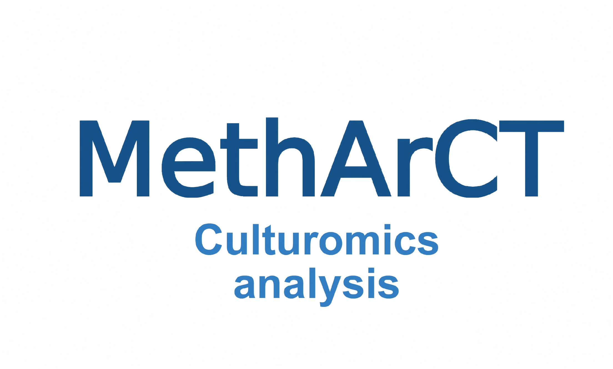

<p align="center">
  
</p>

# MethArCT - Methanogenic Archaeal Culturomics Toolkit

## Overview

MethArCT (Methanogenic Archaeal Culturomics Toolkit) is a comprehensive toolbox designed for metagenomic and genomic analysis of methanogenic archaea. It integrates multiple bioinformatics analysis functions to predict microbial metabolic pathways, optimal growth temperature, salinity adaptation, pH preference, antibiotic resistance, and cultivability.

Access MethArCT v0.6.0 online at (http://methardb.cn/tools/metharct-beta) for protein-based functional prediction of methanogenic archaea.

## Key Features

### Core Features (Required)
- **Metabolic Pathway Prediction**: Analysis of methane, sulfur, and nitrogen metabolic pathways (21 pathways) based on Diamond tool
- **Cultivability Assessment**: Evaluation of culture difficulty based on metabolic pathways

### Extended Features (Optional)
- **Temperature Prediction**: Growth temperature range prediction (T_min, T_opt, T_max) based on AAC and dipeptide composition using the MLHuaiNanzi PLS regression model
- **Salinity Prediction**: Microbial salinity adaptation prediction based on amino acid composition features using SuSha ensemble learning model
- **pH Prediction**: Growth pH preference prediction (optimum, maximum, minimum) based on genome-wide amino acid composition features using GenomeSpot Lasso regression models
- **Antibiotic Resistance Prediction**: Supports prediction of Bacitracin, Tunicamycin, and Vanadate resistance.
- **Genome Quality Assessment**: Genome completeness and contamination estimation based on CheckM2 — requires CheckM2 tool

## Quick Start

```bash
# 1. Install MethArCT
pip install .

# 2. Run comprehensive analysis
metharct comprehensive "protein.faa" -o results/
```

## System Requirements

### Basic Requirements
- **Python**: >= 3.9
- **Required Tool**: Diamond
- **Operating System**: Windows, Linux

### Optional Tools
- **CheckM2**: For genome quality assessment (optional)

## Quick Installation

### Step 1: Get the Project
```bash
git clone https://github.com/rsj99-dev/MethArCT.git
cd MethArCT
```

### Step 2: Create Python Environment
```bash
# Using conda (recommended)
conda env create -f environment.yml
conda activate metharct

# Or using pip with virtual environment
python -m venv metharct_env
# Windows activation:
metharct_env\Scripts\activate
# Linux/macOS activation:
source metharct_env/bin/activate
```

### Step 3: Install Dependencies
```bash
# Install Python dependencies
pip install -r requirements.txt

# Install project as executable
pip install -e .

# Install Diamond (required)
conda install -c bioconda diamond
```

> **Windows Note**: If `conda install diamond` fails, manually download `diamond.exe` from [Diamond Releases](https://github.com/bbuchfink/diamond/releases) and place it in the **MethArCT-main root directory**.

### Step 4: Verify Installation
```bash
# Test core functionality
python quick_test.py

# Check command line tool
metharct --help
```

## Optional Tools Installation

For temperature prediction or genome quality assessment features:

### CheckM2 Installation (Genome Quality Assessment)
```
Extract "checkm2_db.zip" to the root directory of the MethArCT folder.
```

## Usage Guide

### 1. Command Line Usage (Recommended)

**Core Analysis (Diamond only)**:
```bash
# Metabolic pathway analysis — core feature
metharct diamond "protein.faa" -o results/

# Comprehensive analysis (skip optional tools)
metharct comprehensive "protein.faa" -o results/ --skip-checkm2 --skip-antibiotic
```

**Full Analysis (with optional tools)**:
```bash
# Complete analysis with all features
metharct comprehensive "protein.faa" -o results/

# Run optional analyses separately
metharct susha "protein.faa" -o results/         # Salinity prediction
metharct ph "protein.faa" -o results/            # pH preference prediction
metharct antibiotic "protein.faa" -o results/    # Antibiotic resistance prediction
metharct checkm2 "genome.fasta" -o results/      # Requires CheckM2
```

**Batch Processing (multiple genomes)**:
```bash
# Batch comprehensive analysis for all .faa files in a directory
metharct batch "genomes_folder/" -o results.csv

# For metagenome-assembled genomes (MAGs): show pathways with completeness >= 70%
metharct batch "genomes_folder/" -o results.csv -mags
```

This command processes every FASTA file (`.faa`, `.fa`, `.fasta`) in the given directory and generates a single summary CSV with the following columns:

| Column | Description |
|--------|-------------|
| FAA_filename | Input file name |
| Temperature_range | Estimated growth temperature range |
| Optimal_temperature | Predicted optimal growth temperature (OGT) |
| pH_range | Predicted pH range (min–max) |
| Optimal_pH | Predicted pH optimum |
| Salinity_range | Predicted salinity adaptation range |
| Substrate_metabolism | Energy metabolism pathways (methane, sulfur, nitrogen) with completeness = 100% (or ≥ 70% with `-mags`) |
| Additional_amino_acids_required | Amino acids with incomplete biosynthesis pathways |
| Recommended_antibiotics | Recommended antibiotics based on AAI comparison |

### 2. Python Script Usage
```python
from metharct import MethArCTAnalyzer

analyzer = MethArCTAnalyzer()

# Core functionality only (Diamond analysis)
results = analyzer.analyze_diamond('protein_sequences.faa')

# Antibiotic resistance prediction
results = analyzer.analyze_antibiotic('protein_sequences.faa')

# Full analysis (if optional tools are installed)
results = analyzer.analyze_comprehensive('protein_sequences.faa')

print(results)
```

### 3. Input File Requirements

- **Supported Format**: FASTA format (.fa, .fasta, .faa)
- **File Size**: Recommended not exceeding 50MB
- **Character Encoding**: UTF-8
- **File names with special characters** (e.g., parentheses, spaces) should be quoted

### 4. Output Description

**Core Feature Output (Diamond Analysis)**:
- `[filename]_diamond_summary.csv` — Metabolic pathway summary
- `[filename]_diamond_results.json` — Detailed analysis results
- `[filename]_*_diamond.tsv` — Detailed alignment results for each pathway

**Antibiotic Resistance Prediction Output**:
- `antibiotic_selection_results.tsv` — AAI values, rule evaluation status, and recommended antibiotics

**Comprehensive Analysis Report**:
- `[filename]_integrated_summary.csv` — Integrated assessment results
- `[filename]_comprehensive_analysis.json` — Complete analysis data

**Optional Feature Outputs**:
- SuSha salinity results: `[filename]_SuSha_Summary.tsv` and `[filename]_SuSha_Result.xlsx`
- pH preference results: `[filename]_pH_Summary.tsv` and `[filename]_pH_Details.json`
- CheckM2 results in `[filename]_checkm2/` directory with `quality_report.tsv`

## Troubleshooting

### Installation Issues

**Command line entry point not working**:
```bash
# Alternative way to run
python -m metharct.cli.main --help

# Reinstall project
pip uninstall metharct -y
pip install -e .
```

**Diamond tool not found**:
```bash
conda activate metharct
conda install -c bioconda diamond
diamond --help
```

**Windows: Diamond not found**:
If conda install fails, manually download `diamond.exe` and place it in the MethArCT root directory:
1. Visit https://github.com/bbuchfink/diamond/releases
2. Download the latest `diamond-windows.zip` and extract `diamond.exe`
3. Place `diamond.exe` in the MethArCT-main root folder
4. Re-run the analysis command

**pH prediction module not available**:
```bash
pip install hmmlearn>=0.3.0
```

**SuSha salinity prediction fails with module/import errors**:
The SuSha ensemble model requires `imbalanced-learn`. Make sure it is installed:
```bash
pip install imbalanced-learn>=0.10.0
```

**MLHuaiNanzi temperature prediction not available**:
```bash
pip install scikit-learn>=1.0 numpy>=1.20
```

## AI-Ready Interface (v0.8.0)

MethArCT 0.8.0 adds an **additive** AI layer (`metharct/ai/`) that makes the
toolkit callable by scripts and by local agent hosts. **No scientific
algorithm, threshold, database, model file or legacy output changed.**

Three independent usage paths:

| Path | Entry point |
|---|---|
| Legacy (unchanged) | `metharct comprehensive protein.faa -o results/` |
| Python / JSON CLI | `metharct.ai.MethArCTClient`, `metharct capabilities --format json` |
| MCP (optional) | `metharct-mcp --workspace ./metharct_workspace` |

### Quick start (Python)

```python
from metharct.ai import MethArCTClient

client = MethArCTClient(workspace="./metharct_workspace")
print(client.get_capabilities()["software"]["version"])   # which modules really work here

info = client.inspect_input("protein.faa")                # validate before spending compute
job = client.run_analysis("protein.faa", modules=["temperature", "ph"])
print(job["job_id"], job["status"])

summary = client.get_result_summary(job["job_id"])
print(summary["modules"]["temperature"]["values"])
```

### Quick start (machine-readable CLI)

```bash
metharct capabilities --format json
metharct doctor --format json
metharct inspect protein.faa --format json
metharct run protein.faa --modules temperature,ph --format json
metharct result <job_id> --format json
```

In `--format json` mode stdout contains exactly one UTF-8 JSON object and all
diagnostics go to stderr; exit code `0` = success, `1` = error, `3` = job
failed/partial. Legacy subcommands keep their original text output and do not
gain a `--format` flag.

### Quick start (MCP)

```bash
pip install ".[mcp]"          # requires Python >= 3.10 (MCP SDK constraint)
metharct-mcp --workspace ./metharct_workspace
```

Eight tools (`metharct_capabilities`, `metharct_doctor`,
`metharct_inspect_input`, `metharct_run_analysis`,
`metharct_get_job_status`, `metharct_get_result_summary`,
`metharct_read_artifact`, `metharct_cancel_job`) plus four documentation
resources. The MCP SDK is optional (supported range `mcp>=1.2`, both the 1.x
`FastMCP` and the 2.x `MCPServer` API); MethArCT runs without it, and on
Python 3.8/3.9 `metharct doctor` explains that the MCP server needs 3.10+.

### What a job produces

```text
metharct_workspace/jobs/<job_id>/
├── job.json                  # state machine record
├── metharct_ai_report.json   # unified report (schema_version 1.0)
├── manifest.json             # artifact whitelist
├── logs/{stdout,stderr}.log
└── artifacts/                # the original MethArCT output files
```

`metharct_ai_report.json` records the software version, the input SHA-256,
per-module status, values with units, evidence, limitations, artifact hashes
and the parameters/models used. Missing values are `null` — never `0`, never
"not detected" — and a module that produced no usable value is reported
`partial`, never `success`.

### Documentation

| Document | Content |
|---|---|
| [docs/AI_ADAPTATION_AUDIT.md](docs/AI_ADAPTATION_AUDIT.md) | pre-upgrade audit: real API, CLI, outputs, tests, risks |
| [docs/AI_ADAPTATION_REPORT.md](docs/AI_ADAPTATION_REPORT.md) | delivery report: verification, file inventory, milestones, rollback |
| [docs/AI_API.md](docs/AI_API.md) | Python API, CLI JSON mode, job states, error codes |
| [docs/MCP_TOOLS.md](docs/MCP_TOOLS.md) | MCP tools, schemas, host configuration |
| [docs/AI_REPORT_SCHEMA.md](docs/AI_REPORT_SCHEMA.md) | report/artifact field reference |
| [docs/SECURITY.md](docs/SECURITY.md) | path whitelists, process execution, limits |
| [knowledge/README.md](knowledge/README.md) | curated module/biology/interpretation knowledge |
| [CHANGELOG.md](CHANGELOG.md) | 0.8.0 changes and compatibility statement |

### Tests

```bash
pip install -r requirements-dev.txt     # contributors only; end users need requirements.txt
python -m pytest tests -q
```

`tests/regression/` freezes the legacy CLI arguments, the analyzer signatures,
the config schema and the packaging contract (`requirements.txt` must not ship
dev tooling). `tests/ai/` covers validators, capabilities, jobs, artifacts,
serializers, the report schema, the CLI JSON mode and one real end-to-end job.
`tests/ai/test_mcp_integration.py` drives a real MCP `ClientSession` over stdio
and therefore runs on Python 3.10+ only (it skips with that reason elsewhere).

Verified on Python 3.8.20 (`172 passed, 6 skipped`) and Python 3.12.7 with
`mcp 2.3.0` + `jsonschema 4.26.0` (`177 passed, 1 skipped`).

## LoongArch Support

> **Note**: The LoongArch branch currently supports only the following processors:
> Loongson 3A/B/C/D 5000 & 6000 series, 2K2000, and 2K3000/3B6000M.

## Project Structure

```
MethArCT/
├── metharct/                       # Main package
│   ├── cli/                        # Command line interface
│   ├── core/                       # Core analysis modules
│   │   ├── antibiotic_analyzer.py  # Antibiotic resistance prediction (AAI-based)
│   │   ├── susha/                  # SuSha salinity prediction (embedded)
│   │   ├── mlhuainanzi/              # MLHuaiNanzi temperature prediction (embedded)
│   │   └── ph_predictor/           # pH prediction engine (embedded, GenomeSpot-based)
│   │       ├── models/             # Pre-trained Lasso regression models
│   │       └── hmm/                # Signal peptide HMM model
│   └── utils/                      # Utility functions
├── data/                           # Reference databases
│   ├── databases/                  # Diamond databases
│   │   └── kangshengsu/            # Methanogen reference genomes for antibiotic prediction
│   ├── methane/                    # Methane metabolism genes
│   ├── nitrogen/                   # Nitrogen metabolism genes
│   └── sulfur/                     # Sulfur metabolism genes
├── requirements.txt                # Python dependencies
└── setup.py                        # Package setup
```

## License

This project is licensed under the **GNU General Public License v3.0 (GPL-3.0)** — see the [LICENSE](LICENSE) file for details.

**License history:**
- Versions **≤ 0.5.5** were released under the **MIT License** — see [LICENSE-MIT](LICENSE-MIT) for the original terms.
- Starting from version **0.6.0**, the project is relicensed under **GPL-3.0** to comply with GPL-3.0 licensed dependencies (CheckM2).

**Third-party components:**
- **CheckM2** (genome quality assessment) — GPL-3.0

## Citation

If you use MethArCT in your research, please cite:

[Coming soon]
